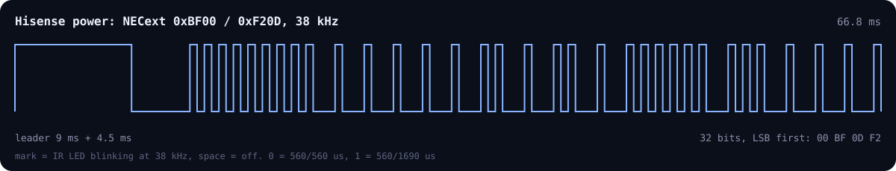

# IR Remote TV · Telecomando IR

**Un telecomando a infrarossi per Android piccolissimo, per quasi tutte le TV: 107 marche, 348 telecomandi, scorciatoie per le app, un touchpad per i menu delle smart TV e la ricerca automatica del modello. 94 KB, offline, senza pubblicità.**

[Sito](https://ir-remote-tv.pages.dev) · [Scarica l'APK](https://github.com/diegobruvhrpiugvjrigjtibjte/ir-remote-tv/releases/latest) · [Documentazione](docs/README.md) · [English](README.md) · **Italiano**

## Cosa fa

- **107 marche, 348 telecomandi** dal database pubblico Flipper-IRDB: Samsung, LG, Sony, Hisense, TCL, Philips, Panasonic, Sharp, Toshiba, Vizio, Roku, Thomson, Grundig, JVC, Haier e molte altre ([elenco completo](docs/it/03-marche-supportate.md))
- **Tutti i tasti**: accensione, volume, canali, sorgente, frecce, OK, menu, home, indietro, esci, info, guida, impostazioni, numeri, tasti colorati, riproduzione, sottotitoli, sleep, televideo
- **Scorciatoie per le app**: YouTube, Netflix, Prime Video, Disney+, Spotify, se il telecomando originale le ha
- **Touchpad**: trascina per muoverti nei menu delle smart TV, tocca per OK
- **Ricerca del modello**: prova il codice di accensione di ogni modello di una marca, o di tutte le marche, finché la TV reagisce
- **Tieni premuto per ripetere** volume, canali e frecce; vibrazione a ogni tasto
- **Segnali generati sul telefono**: NEC, NECext, NEC42, Samsung32, Sony SIRC, Philips RC5/RC6 e codici grezzi

## Requisiti

Un telefono con **trasmettitore a infrarossi**, come Samsung Galaxy S4/S5/Note 3/Note 4 o molti Xiaomi. Dal Galaxy S6 in poi (S20+ compreso) non c'è. Android 4.4 o successivo.

## Installazione

Scarica `IR-Remote-TV-2.0.apk` dall'[ultima release](https://github.com/diegobruvhrpiugvjrigjtibjte/ir-remote-tv/releases/latest), aprilo sul telefono, consenti le origini sconosciute e installa. Passo per passo: [Installazione](docs/it/01-installazione.md).

## Uso

1. Tocca la marca e cerca la tua.
2. Punta il **bordo superiore** del telefono verso la TV e premi **Accendi / Spegni**.
3. Non succede niente? Tocca **Trova il modello giusto di ...** e poi **Stop** quando la TV reagisce.

## Documentazione

| Italiano | English |
|---|---|
| [1. Installazione](docs/it/01-installazione.md) | [1. Install](docs/en/01-install.md) |
| [2. Guida utente](docs/it/02-guida-utente.md) | [2. User guide](docs/en/02-user-guide.md) |
| [3. Marche supportate](docs/it/03-marche-supportate.md) | [3. Supported brands](docs/en/03-supported-brands.md) |
| [4. Come funziona](docs/it/04-come-funziona.md) | [4. How it works](docs/en/04-how-it-works.md) |
| [5. Compilare dai sorgenti](docs/it/05-compilare.md) | [5. Build from source](docs/en/05-build-from-source.md) |
| [6. Problemi e FAQ](docs/it/06-problemi-faq.md) | [6. Troubleshooting and FAQ](docs/en/06-troubleshooting-faq.md) |

## Stato

10 test unitari superati, compreso uno che genera ogni tasto di ogni telecomando del database. La prova reale è in corso su un Galaxy S4 con una TV Hisense: se una marca non risponde, apri una issue con marca e modello della TV.

## Licenza

Codice dell'app [MIT](LICENSE). Database derivato da [Flipper-IRDB](https://github.com/Lucaslhm/Flipper-IRDB), CC0 1.0 (vedi [NOTICE](NOTICE)).
