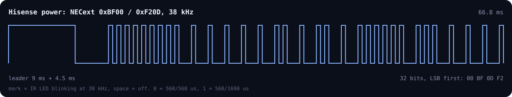

<div align="center">

# IR Remote TV

**A tiny Android infrared remote for almost every TV: 107 brands, 348 remotes, app shortcuts, a touchpad for smart-TV menus and an automatic model finder. 94 KB, offline, no ads.**

[](https://github.com/diegobruvhrpiugvjrigjtibjte/ir-remote-tv/releases/latest)
[](LICENSE)
[](docs/en/01-install.md)

[Website](https://ir-remote-tv.pages.dev) · [Download APK](https://github.com/diegobruvhrpiugvjrigjtibjte/ir-remote-tv/releases/latest) · [Documentation](docs/README.md) · **English** · [Italiano](README.it.md)



</div>

## What it does

- **107 brands, 348 remotes** from the public Flipper-IRDB database: Samsung, LG, Sony, Hisense, TCL, Philips, Panasonic, Sharp, Toshiba, Vizio, Roku, Thomson, Grundig, JVC, Haier and many more ([full list](docs/en/03-supported-brands.md))
- **Every key**: power, volume, channels, input, arrows, OK, menu, home, back, exit, info, guide, settings, numbers, colour keys, playback, subtitles, sleep, teletext
- **App shortcuts**: YouTube, Netflix, Prime Video, Disney+, Spotify, when the original remote has them
- **Touchpad**: drag to move through smart-TV menus, tap for OK
- **Model finder**: tries the power code of every model of a brand, or of every brand, until the TV reacts
- **Hold to repeat** for volume, channels and arrows; vibration on every key
- **Signals generated on the phone**: NEC, NECext, NEC42, Samsung32, Sony SIRC, Philips RC5/RC6 and raw codes

## Requirements

A phone with an **infrared transmitter**, such as the Samsung Galaxy S4/S5/Note 3/Note 4 or many Xiaomi models. The Galaxy S6 and later (S20+ included) have none. Android 4.4 or later.

## Install

Download `IR-Remote-TV-2.0.apk` from the [latest release](https://github.com/diegobruvhrpiugvjrigjtibjte/ir-remote-tv/releases/latest), open it on the phone, allow unknown sources and install. Step by step: [Install](docs/en/01-install.md).

## Use

1. Tap the brand, search yours.
2. Point the **top edge** of the phone at the TV and press **Accendi / Spegni** (power).
3. Nothing happens? Tap **Trova il modello giusto di ...** and tap **Stop** when the TV reacts.

The interface is in Italian; the [user guide](docs/en/02-user-guide.md) translates every label.

## Documentation

| English | Italiano |
|---|---|
| [1. Install](docs/en/01-install.md) | [1. Installazione](docs/it/01-installazione.md) |
| [2. User guide](docs/en/02-user-guide.md) | [2. Guida utente](docs/it/02-guida-utente.md) |
| [3. Supported brands](docs/en/03-supported-brands.md) | [3. Marche supportate](docs/it/03-marche-supportate.md) |
| [4. How it works](docs/en/04-how-it-works.md) | [4. Come funziona](docs/it/04-come-funziona.md) |
| [5. Build from source](docs/en/05-build-from-source.md) | [5. Compilare dai sorgenti](docs/it/05-compilare.md) |
| [6. Troubleshooting and FAQ](docs/en/06-troubleshooting-faq.md) | [6. Problemi e FAQ](docs/it/06-problemi-faq.md) |

## Build

```bash
./gradlew :app:testDebugUnitTest :app:assembleRelease
```

Details and database regeneration: [Build from source](docs/en/05-build-from-source.md).

## Status

10 unit tests pass, including one that encodes every button of every remote in the database. Real-world testing is ongoing on a Galaxy S4 with a Hisense TV: if a brand does not respond, please open an issue with brand and TV model.

## License

App code [MIT](LICENSE). Remote database derived from [Flipper-IRDB](https://github.com/Lucaslhm/Flipper-IRDB), CC0 1.0 (see [NOTICE](NOTICE)).
